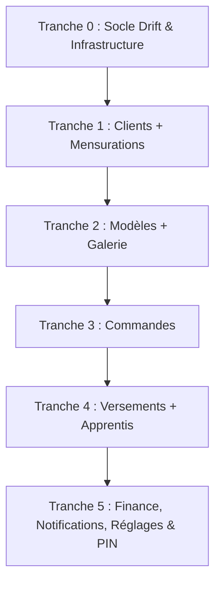

# État des lieux et Inventaire Backend — Angela Déesse

Date de réalisation : 2 novembre 2026  
Branche de travail : `feat/local-db`  
Référence projet : [claude.md](file:///home/othnelio/Angela/Angela_Deesse/claude.md)  
Statut code applicatif : Non modifié (lecture seule)  

---

## A. Entités du domaine

### 1. Client (`lib/data/models.dart`)
- **Champs et types Dart** :
  - `id` : `String`
  - `name` : `String`
  - `phone` : `String` (défaut : `''`)
  - `notes` : `String` (défaut : `''`)
- **Type actuel de l'identifiant** : `String` (généré via `newId()` dans `ClientFormScreen`, ou `'c$i'` dans `_seed()`).
- **Relations** :
  - 1-N vers `Measurement` (`Measurement.clientId`)
  - 1-N vers `Order` (`Order.clientId`)
  - 1-N vers `Realisation` (`Realisation.clientId`, optionnel)
- **Énumérations utilisées** : Aucune.
- **État `toMap()` / `fromMap()`** :
  - `toMap()` : `{'id': id, 'name': name, 'phone': phone, 'notes': notes}`
  - `fromMap()` : `Client(id: m['id'] as String, name: _s(m['name']), phone: _s(m['phone']), notes: _s(m['notes']))`
  - **Lacunes** : Absence des champs de synchronisation et d'audit requis par `claude.md` (§6) : `created_at`, `updated_at`, `deleted_at`. Identifiant non conforme UUIDv7 standard.

---

### 2. Measurement (`lib/data/models.dart`)
- **Champs et types Dart** :
  - `id` : `String`
  - `clientId` : `String`
  - `takenAt` : `DateTime`
  - `values` : `Map<String, double>` (mesures en cm)
  - `note` : `String` (défaut : `''`)
- **Type actuel de l'identifiant** : `String` (`'m$c'` dans `_seed()`, `newId()` dans `MeasurementFormScreen`).
- **Relations** :
  - N-1 vers `Client` (`clientId`).
- **Énumérations utilisées** : Pas d'enum formelle. Liste constante `kMeasureLabels` (12 mesures par défaut : Épaules, Tour de poitrine, Tour de taille, Tour de bassin, Longueur dos, Longueur manche, Tour de bras, Longueur robe, Longueur jupe, Longueur pantalon, Tour de cuisse, Entrejambe) + saisies personnalisées dynamiques.
- **État `toMap()` / `fromMap()`** :
  - `toMap()` : `{'id': id, 'client_id': clientId, 'taken_at': takenAt.millisecondsSinceEpoch, 'vals': jsonEncode(values), 'note': note}`
  - `fromMap()` : `values` désérialisé par `jsonDecode(m['vals'] as String)` puis mappé en `(v as num).toDouble()`.
  - **Lacunes** : `values` est encapsulé en chaîne JSON (`vals`). Absence des champs d'audit/sync (`created_at`, `updated_at`, `deleted_at`).

---

### 3. Modele (`lib/data/models.dart`)
- **Champs et types Dart** :
  - `id` : `String`
  - `name` : `String`
  - `description` : `String` (défaut : `''`)
  - `photo` : `String?` (nullable)
- **Type actuel de l'identifiant** : `String` (`'mo$i'` dans `_seed()`, `newId()` dans `ModeleFormScreen`).
- **Relations** :
  - 1-N vers `Order` (`Order.modeleId`, optionnel).
- **Énumérations utilisées** : Aucune.
- **État `toMap()` / `fromMap()`** :
  - `toMap()` : `{'id': id, 'name': name, 'description': description, 'photo': photo}`
  - `fromMap()` : complet pour les 4 champs.
  - **Lacunes** : Absence de champs d'audit/sync (`created_at`, `updated_at`, `deleted_at`). Le champ `photo` stocke un identifiant simulé (`demo:N`) sans hash ni statut d'upload.

---

### 4. Order (`lib/data/models.dart`)
- **Champs et types Dart** :
  - `id` : `String`
  - `clientId` : `String`
  - `modeleId` : `String?` (optionnel)
  - `title` : `String`
  - `fabric` : `String` (défaut : `''`)
  - `price` : `int` (FCFA)
  - `deliveryDate` : `DateTime`
  - `fittingDate` : `DateTime?` (optionnel)
  - `status` : `OrderStatus` (défaut : `OrderStatus.attente`)
  - `photos` : `List<String>` (défaut : `const []`)
  - `createdAt` : `DateTime`
  - Propriété calculée : `bool get isActive => status != OrderStatus.livree;`
- **Type actuel de l'identifiant** : `String` (`'o$i'` dans `_seed()`, `newId()` dans `OrderFormScreen`).
- **Relations** :
  - N-1 vers `Client` (`clientId`).
  - N-1 vers `Modele` (`modeleId`, nullable).
  - 1-N vers `ClientPayment` (`ClientPayment.orderId`).
- **Énumérations utilisées** :
  - `OrderStatus` : `attente` ('En attente'), `cours` ('En cours'), `prete` ('Prête'), `livree` ('Livrée').
- **État `toMap()` / `fromMap()`** :
  - `toMap()` : sérialise les dates en `millisecondsSinceEpoch`, `status.name`, et `photos` via `jsonEncode(photos)`.
  - `fromMap()` : désérialise `photos` via `jsonDecode`.
  - **Lacunes** : `photos` sérialisé en JSON brut. Absence de `updated_at` et `deleted_at`.

---

### 5. ClientPayment (`lib/data/models.dart`)
- **Champs et types Dart** :
  - `id` : `String`
  - `orderId` : `String`
  - `amount` : `int` (FCFA)
  - `paidAt` : `DateTime`
  - `note` : `String` (défaut : `''`)
- **Type actuel de l'identifiant** : `String` (`'p${i}a'` dans `_seed()`, `newId()` dans `addClientPayment()`).
- **Relations** :
  - N-1 vers `Order` (`orderId`).
- **Énumérations utilisées** : Aucune.
- **État `toMap()` / `fromMap()`** :
  - `toMap()` : complet pour les 5 champs actuels.
  - `fromMap()` : complet pour les 5 champs actuels.
  - **Lacunes critiques** :
    - **Absence de numéro de reçu (`receiptNo`)** : `ClientPayment` ne stocke aucun numéro de reçu, contrairement à `ApprenticePayment`. Dans l'écran de reçu, le numéro est actuellement simulé ou dérivé de l'identifiant.
    - Absence des champs de synchronisation (`created_at`, `updated_at`, `deleted_at`).

---

### 6. Apprentice (`lib/data/models.dart`)
- **Champs et types Dart** :
  - `id` : `String`
  - `name` : `String`
  - `phone` : `String` (défaut : `''`)
  - `startDate` : `DateTime`
  - `totalFee` : `int` (FCFA)
  - `nextDue` : `DateTime?` (optionnel)
  - `notes` : `String` (défaut : `''`)
- **Type actuel de l'identifiant** : `String` (`'a$i'` dans `_seed()`, `newId()` dans `ApprenticeFormScreen`).
- **Relations** :
  - 1-N vers `ApprenticePayment` (`ApprenticePayment.apprenticeId`).
- **Énumérations utilisées** : Aucune.
- **État `toMap()` / `fromMap()`** :
  - `toMap()` : complet pour les 7 champs.
  - `fromMap()` : complet pour les 7 champs.
  - **Lacunes** : Absence de `created_at`, `updated_at`, `deleted_at`.

---

### 7. ApprenticePayment (`lib/data/models.dart`)
- **Champs et types Dart** :
  - `id` : `String`
  - `apprenticeId` : `String`
  - `amount` : `int` (FCFA)
  - `paidAt` : `DateTime`
  - `note` : `String` (défaut : `''`)
  - `receiptNo` : `int` (séquentiel 1, 2, 3...)
- **Type actuel de l'identifiant** : `String` (`'ap$i'` dans `_seed()`, `newId()` dans `addApprenticePayment()`).
- **Relations** :
  - N-1 vers `Apprentice` (`apprenticeId`).
- **Énumérations utilisées** : Aucune.
- **État `toMap()` / `fromMap()`** :
  - `toMap()` : complet pour les 6 champs.
  - `fromMap()` : complet pour les 6 champs.
  - **Lacunes** : Absence de `created_at`, `updated_at`, `deleted_at`. Le `receiptNo` est actuellement calculé en mémoire (`max + 1`).

---

### 8. Realisation (`lib/data/models.dart`)
- **Champs et types Dart** :
  - `id` : `String`
  - `photo` : `String`
  - `category` : `String` (défaut : `'Autre'`)
  - `clientId` : `String?` (optionnel)
  - `caption` : `String` (défaut : `''`)
  - `createdAt` : `DateTime`
- **Type actuel de l'identifiant** : `String` (`'r$i'` dans `_seed()`, `newId()` dans `RealisationFormScreen`).
- **Relations** :
  - N-1 vers `Client` (`clientId`, optionnel).
- **Énumérations utilisées** : Pas d'enum formelle. Constante `kCategories` (`'Robe'`, `'Chemise'`, `'Costume'`, `'Pagne'`, `'Enfant'`, `'Autre'`).
- **État `toMap()` / `fromMap()`** :
  - `toMap()` : complet pour les 6 champs.
  - `fromMap()` : complet pour les 6 champs.
  - **Lacunes** : Absence de `updated_at` et `deleted_at`. La photo ne contient aucun hash/statut de sync.

---

### 9. Réglages et Paramètres (État éclaté, non modélisé)
- **Modèle de données** : **Absent** dans `lib/data/models.dart`.
- **Champs actuellement existants** :
  - Dans `AppStore` : `atelierName` (`String`, défaut `'Angela Couture'`).
  - Dans `SettingsScreen` (état local de widget) :
    - `_delivery` (`bool`, défaut `true`)
    - `_fitting` (`bool`, défaut `true`)
    - `_payments` (`bool`, défaut `true`)
    - `_late` (`bool`, défaut `true`)
  - Dans `LockScreen` : code PIN absent, variable locale temporaire de 4 chiffres.
- **Lacunes** : Aucune table, aucune sérialisation `toMap()`/`fromMap()`, aucune persistance.

---

### 10. ReceiptData (`lib/screens/receipt_screen.dart`)
- **DTO d'affichage** non persisté :
  - `receiptNo`: `String`
  - `atelierName`: `String`
  - `title`: `String`
  - `beneficiaryName`: `String`
  - `beneficiaryRole`: `String` (`'Apprenti(e)'` ou `'Client(e)'`)
  - `beneficiaryPhone`: `String`
  - `date`: `DateTime`
  - `amountPaid`: `int`
  - `note`: `String`
  - `totalFee`: `int`
  - `totalPaidToDate`: `int`
  - `remainingAmount`: `int`
  - `nextDueDate`: `DateTime?`
  - `stampText`: `String` (`'VERSÉ'`, `'PAYÉ'`, `'SOLDÉ'`)
  - `itemDetail`: `String?`

---

## B. Argent et dates

### 1. Stockage et calcul des montants
- **Type utilisé pour l'argent** : Strictement des entiers `int` en FCFA dans l'ensemble des modèles de données et de l'état applicatif (`Order.price`, `ClientPayment.amount`, `Apprentice.totalFee`, `ApprenticePayment.amount`, `ReceiptData.*`).
- **Conformité règle zéro `double`** : Respectée au niveau des données métier. Les seuls `double` manipulés sont :
  - Les mensurations physiques (`Measurement.values: Map<String, double>` en cm).
  - Les calculs de ratios géométriques pour les jauges d'avancement graphique (ex: `(paid / o.price).clamp(0, 1).toDouble()`) et la hauteur des barres dans `FinanceScreen` (`maxV`).
- **Fonctions utilitaires monétaires** :
  - `lib/core/format.dart:7` : `fcfa(num v)` formate le montant avec séparateurs d'espaces normaux (insecables nettoyés pour impression/PDF).
  - `lib/widgets/common.dart:703` : `parseMoney(String s)` extrait les chiffres et retourne un `int`.
- **Lieux de calcul du reliquat** :
  - **Dans `AppStore`** (`lib/data/store.dart`) :
    - `paidOf(Order o)` : `paymentsOfOrder(o.id).fold(0, (s, p) => s + p.amount)`
    - `remainingOf(Order o)` : `(o.price - paidOf(o)).clamp(0, 1 << 40).toInt()`
    - `clientRemaining(String clientId)` : somme des `remainingOf(o)` des commandes du client.
    - `totalClientRemaining` : somme globale des `remainingOf(o)`.
    - `apprenticePaid(Apprentice a)` : `paymentsOfApprentice(a.id).fold(0, (s, p) => s + p.amount)`
    - `apprenticeRemaining(Apprentice a)` : `(a.totalFee - apprenticePaid(a)).clamp(0, 1 << 40).toInt()`
    - `totalApprenticeRemaining` : somme globale des `apprenticeRemaining(a)`.
  - **Calculs locaux redondants dans les écrans** :
    - `lib/screens/order_detail_screen.dart:12-13` : recalcule le cumul payé à date `toDate` et `remaining` pour le reçu.
    - `lib/screens/apprentice_detail_screen.dart:11-12` : recalcule le cumul payé jusqu'au reçu `p.receiptNo` et le solde restant.
    - `lib/screens/apprentice_screen.dart:65` et `96` : calcul du reliquat `(totalFee - initialPay)`.
    - `lib/screens/order_form_screen.dart:68` : clamp de l'acompte initial.

### 2. Représentation des dates
- **Dans les modèles Dart** : Tous les champs temporels sont typés `DateTime` ou `DateTime?`.
- **Dans la sérialisation (`toMap()` / `fromMap()`)** :
  - Converties en entiers millisecondes UNIX via `DateTime.millisecondsSinceEpoch`.
  - Désérialisées via `_d(v) => DateTime.fromMillisecondsSinceEpoch((v as num).toInt())` et `_dn(v)`.
- **Calculs de délais** (`lib/core/format.dart`) :
  - `today()` normalise la date du jour à minuit via `DateUtils.dateOnly(DateTime.now())`.
  - `daysUntil(DateTime d)` calcule l'écart en jours calendaires entiers par rapport à `today()`.

---

## C. AppStore

### 1. Méthodes publiques de `AppStore` (`lib/data/store.dart`)
- **Propriétés d'état (en mémoire)** :
  - `String atelierName`
  - `List<Client> clients`
  - `List<Measurement> measurements`
  - `List<Modele> modeles`
  - `List<Order> orders`
  - `List<ClientPayment> clientPayments`
  - `List<Apprentice> apprentices`
  - `List<ApprenticePayment> apprenticePayments`
  - `List<Realisation> realisations`
- **Méthodes d'écriture** :
  - `void setAtelierName(String v)`
  - `Future<void> saveClient(Client c)`
  - `Future<void> deleteClient(String id)` (supprime en cascade locale : commandes, paiements clients de ces commandes, mensurations)
  - `Future<void> saveMeasurement(Measurement m)`
  - `Future<void> deleteMeasurement(String id)`
  - `Future<void> saveOrder(Order o)`
  - `Future<void> deleteOrder(String id)` (supprime en cascade locale : paiements clients de cette commande)
  - `Future<void> addClientPayment(String orderId, int amount, String note)`
  - `Future<void> deleteClientPayment(String id)`
  - `Future<void> saveModele(Modele m)`
  - `Future<void> deleteModele(String id)`
  - `Future<void> saveApprentice(Apprentice a)`
  - `Future<void> deleteApprentice(String id)` (supprime en cascade locale : versements apprentis)
  - `Future<ApprenticePayment> addApprenticePayment(String apprenticeId, int amount, String note)` (génère séquentiellement `receiptNo = max + 1`)
  - `Future<void> deleteApprenticePayment(String id)`
  - `Future<void> saveRealisation(Realisation r)`
  - `Future<void> deleteRealisation(String id)`
- **Méthodes de lecture et lookups** :
  - `Client? clientById(String? id)`
  - `Order? orderById(String? id)`
  - `Modele? modeleById(String? id)`
  - `Apprentice? apprenticeById(String? id)`
  - `List<Order> ordersOfClient(String clientId)`
  - `List<Measurement> measurementsOf(String clientId)`
  - `List<ClientPayment> paymentsOfOrder(String orderId)`
  - `List<ApprenticePayment> paymentsOfApprentice(String id)`
- **Calculs et getters dérivés** :
  - `int paidOf(Order o)`
  - `int remainingOf(Order o)`
  - `int clientRemaining(String clientId)`
  - `int get totalClientRemaining`
  - `int apprenticePaid(Apprentice a)`
  - `int apprenticeRemaining(Apprentice a)`
  - `int get totalApprenticeRemaining`
  - `List<Order> get activeOrders`
  - `List<Order> get lateOrders`

### 2. Appels de `AppStore` par écran
| Écran (`lib/screens/` ou `shell/` ou `widgets/`) | Propriétés et méthodes de `AppStore` appelées |
|---|---|
| `shell/app_shell.dart` | `store.atelierName` |
| `screens/home_screen.dart` | `s.activeOrders`, `s.clientById()`, `s.remainingOf()` |
| `screens/orders_screen.dart` | `s.orders` (filtrage local et tri) |
| `screens/order_detail_screen.dart` | `s.orderById()`, `s.clientById()`, `s.paidOf()`, `s.remainingOf()`, `s.paymentsOfOrder()`, `s.atelierName`, `s.deleteOrder()`, `s.saveOrder()`, `s.saveRealisation()`, `s.addClientPayment()`, `s.deleteClientPayment()` |
| `screens/order_form_screen.dart` | `s.modeleById()`, `s.clients`, `s.modeles`, `s.saveOrder()`, `s.addClientPayment()` |
| `screens/clients_screen.dart` | `s.clients`, `s.clientRemaining()` |
| `screens/client_detail_screen.dart` | `s.clientById()`, `s.measurementsOf()`, `s.ordersOfClient()`, `s.clientRemaining()`, `s.deleteClient()`, `s.deleteMeasurement()` |
| `screens/client_form_screen.dart` | `s.saveClient()` |
| `screens/measurement_form_screen.dart` | `s.measurementsOf()`, `s.saveMeasurement()` |
| `screens/apprentices_screen.dart` | `s.apprentices`, `s.apprenticePaid()`, `s.apprenticeRemaining()` |
| `screens/apprentice_detail_screen.dart` | `s.apprenticeById()`, `s.apprenticePaid()`, `s.apprenticeRemaining()`, `s.paymentsOfApprentice()`, `s.atelierName`, `s.deleteApprentice()`, `s.addApprenticePayment()`, `s.deleteApprenticePayment()` |
| `screens/apprentice_screen.dart` (Form) | `store.atelierName`, `store.saveApprentice()`, `store.addApprenticePayment()` |
| `screens/modeles_screen.dart` | `s.modeles` |
| `screens/modele_screen.dart` (Form & Detail) | `s.saveModele()`, `s.modeleById()`, `s.deleteModele()` |
| `screens/gallery_screen.dart` (List, Form, Detail) | `s.realisations`, `s.clients`, `s.saveRealisation()`, `s.deleteRealisation()`, `s.clientById()` |
| `screens/finance_screen.dart` | `s.clientPayments`, `s.apprenticePayments`, `s.totalClientRemaining`, `s.totalApprenticeRemaining`, `s.orderById()`, `s.clientById()`, `s.apprenticeById()` |
| `screens/notifications_screen.dart` | `s.activeOrders`, `s.apprentices`, `s.clientById()`, `s.remainingOf()`, `s.apprenticeRemaining()` |
| `screens/settings_screen.dart` | `s.atelierName`, `s.setAtelierName()` |
| `widgets/order_tile.dart` | `s.clientById()`, `s.remainingOf()` |
| `screens/receipt_screen.dart` | Aucun appel direct (reçoit le DTO `ReceiptData`). |
| `screens/lock_screen.dart` | Aucun appel. |
| `screens/splash_screen.dart` | Aucun appel. |

### 3. Données de démonstration créées par `_seed()`
- **Localisation** : `lib/data/store.dart`, lignes 33 à 120.
- **Détail des données injectées au démarrage** :
  - **9 Clients** (l. 34-42) : `c0` à `c8` (Ama Mensah, Yawa Kpogo, Adjoa Agbodjan, Akouvi Lawson, Afi Dosseh, Edem Amegah, Mawussi Koffi, Abla Tchalla, Dzifa Ayivi). `c1` contient la note « Préfère les coupes ajustées. ».
  - **3 Mensurations** (l. 44-50) : Pour `c0`, `c1`, `c2` avec dates `_day(-20 - k)` et 6 mesures clés.
  - **6 Modèles** (l. 52-62) : `mo0` à `mo5` (Robe sirène, Ensemble pagne, Chemise bazin, Costume 3 pièces, Boubou brodé, Robe enfant), avec photos `'demo:0'` à `'demo:5'`.
  - **15 Commandes** (l. 64-89) : `o0` à `o14`, dates de livraison relatives de -20 à +25 jours, statuts variés (3 livrées, 3 attente, 8 cours, 1 prête), photos `'demo:1'` à `'demo:15'`.
  - **18 Paiements de clients** (l. 90-98) : Acomptes et compléments calculés (`p${i}a`, `p${i}b`).
  - **3 Apprentis** (l. 100-104) : `a0` (Kafui Amedome, total 150 000 FCFA), `a1` (Mawuli Sodji, total 120 000 FCFA), `a2` (Essi Gbadoe, total 150 000 FCFA).
  - **5 Versements d'apprentis** (l. 105-110) : `ap0` à `ap4`, montants de 30 000 à 100 000 FCFA, numéros de reçus séquentiels 1 à 5.
  - **9 Réalisations de galerie** (l. 112-118) : `r0` à `r8`, photos `'demo:2'` à `'demo:10'`, catégories diverses rattachées aux clients `c0` à `c5`.

---

## D. Éléments factices à remplacer (liste précise fichier + ligne)

### 1. Identifiants `demo:` et photos simulées
- `lib/data/store.dart:61` : `photo: 'demo:$i'` (modèles de démo).
- `lib/data/store.dart:88` : `photos: ['demo:${i + 1}']` (commandes de démo).
- `lib/data/store.dart:115` : `photo: 'demo:${i + 2}'` (réalisations de démo).
- `lib/widgets/common.dart:491-500` : Constante `_demoGradients` (8 dégradés simulant des photos).
- `lib/widgets/common.dart:502` : Compteur d'indice démo `int _demoIndex = 0;`.
- `lib/widgets/common.dart:533` : `return 'demo:${_demoIndex++ % _demoGradients.length}';` dans `pickPhoto()`.
- `lib/widgets/common.dart:544-558` : Détection `path.startsWith('demo:')` et rendu d'un dégradé + icône cintre dans `PhotoThumb`.
- `lib/widgets/common.dart:565-578` : Visualisation plein écran `openPhoto()` affichant la tuile démo.

### 2. Actions WhatsApp / SMS / Appel / Impression simulées
- **Bouton Partage WhatsApp** :
  - `lib/screens/receipt_screen.dart:160-162` :
    ```dart
    void _shareWhatsApp() {
      toast(context, 'Reçu prêt pour envoi WhatsApp au ${widget.data.beneficiaryPhone.isNotEmpty ? widget.data.beneficiaryPhone : widget.data.beneficiaryName}');
    }
    ```
  - `lib/screens/receipt_screen.dart:373` : Bouton WhatsApp appelant `_shareWhatsApp`.
- **Bouton Téléchargement / PDF du reçu** :
  - `lib/screens/receipt_screen.dart:164-166` :
    ```dart
    void _downloadReceipt() {
      toast(context, 'Reçu N° ${widget.data.receiptNo} enregistré dans Téléchargements (PDF)');
    }
    ```
  - `lib/screens/receipt_screen.dart:202` (AppBar) et `receipt_screen.dart:355` (bouton principal).
- **Bouton Impression du reçu** :
  - `lib/screens/receipt_screen.dart:168-170` :
    ```dart
    void _printReceipt() {
      toast(context, 'Connexion à l\'imprimante de reçus... Impression lancée !');
    }
    ```
  - `lib/screens/receipt_screen.dart:197` (AppBar).
- **Boutons WhatsApp / Appel / SMS manquants dans l'UI** :
  - Les numéros de téléphone sont affichés en texte pur sans action clickable dans :
    - `lib/screens/client_detail_screen.dart:70` (`Text(c.phone)`)
    - `lib/screens/apprentice_detail_screen.dart:80` (`Text(a.phone)`)
    - `lib/screens/clients_screen.dart:61` (`Text(list[i].phone)`)
  - Aucun bouton direct `tel:` ou `sms:` ou WhatsApp de relance sur commande n'existe actuellement.

### 3. Gestion du code PIN (`LockScreen`)
- `lib/screens/lock_screen.dart:13` : `String _entry = '';`
- `lib/screens/lock_screen.dart:26-30` :
  ```dart
  if (_entry.length == 4) {
    _timer = Timer(const Duration(milliseconds: 220), () {
      if (mounted) Navigator.of(context).pop();
    });
  }
  ```
- `lib/screens/lock_screen.dart:42` : Bouton de fermeture permettant de quitter sans saisir le code.
- **Diagnostic** : N'importe quel code à 4 chiffres ouvre l'écran. Aucun hashage, aucun stockage sécurisé (`flutter_secure_storage`), aucune vérification de validité, aucune interface de définition/modification du PIN, et l'écran n'est pas invoqué au démarrage de l'app.

### 4. Interrupteurs de notifications (`SettingsScreen`)
- `lib/screens/settings_screen.dart:13` : `bool _delivery = true, _fitting = true, _payments = true, _late = true;`
- `lib/screens/settings_screen.dart:81` : Switch Livraisons
- `lib/screens/settings_screen.dart:82` : Switch Essayages
- `lib/screens/settings_screen.dart:83` : Switch Paiements
- `lib/screens/settings_screen.dart:84` : Switch Commandes en retard
- **Diagnostic** : Purement graphiques (variables d'état de widget local). Non persistés, non liés au store ni aux alarmes du système d'exploitation.

### 5. Génération de reçu (`ReceiptScreen`)
- **Éléments calculés** :
  - Montant versé, reliquat dynamique `remainingAmount`, statut `stampText` (`VERSÉ`, `PAYÉ`, `SOLDÉ`), animation thermique en 5 étapes.
- **Éléments simulés / factices** :
  - `lib/screens/order_detail_screen.dart:14` : Extraction bricolée des chiffres de l'identifiant pour le numéro de reçu client (`cp.id.replaceAll(RegExp(r'[^0-9]'), '')`).
  - `lib/screens/order_detail_screen.dart:173` : Numéro de reçu client aléatoire simulé par timestamp : `'${(DateTime.now().millisecondsSinceEpoch % 10000)}'.padLeft(4, '0')`.
  - `lib/screens/receipt_screen.dart:577` : Libellé `'Total formation'` codé en dur même pour les reçus de commandes clients.
  - `lib/screens/receipt_screen.dart:593` & `639-654` : Faux code-barres décoratif statique (`_BarcodeArt`).
  - `lib/screens/receipt_screen.dart:160, 164, 168` : Faux boutons de partage, téléchargement et impression.

### 6. Autres simulations repérées
- `lib/screens/finance_screen.dart:17` : Historique des 5 mois précédents généré en dur (`values = <int>[182000, 241000, 198000, 276000, 231000, monthTotal]`).
- `lib/screens/notifications_screen.dart:21` & `58` : Variable `_read = false` purement locale, sans persistance des notifications lues.

---

## E. Analyse

### 1. Ordre de migration recommandé (tranches verticales)

En application stricte de la stratégie par tranches verticales de `claude.md` (§5 et §11) :



1. **Tranche 0 — Socle technique Drift & Outbox** :
   - Ajout des dépendances Drift + SQLite + build_runner.
   - Définition du schéma Drift complet (toutes les tables sync-ready avec `id`, `created_at`, `updated_at`, `deleted_at`).
   - Table `sync_outbox`.
   - Migration d'`AppStore` pour brancher des flux Drift réactifs en arrière-plan sans casser l'interface des méthodes existantes.
2. **Tranche 1 — Clients + Mensurations** :
   - Écrans : `ClientFormScreen` -> `ClientsScreen` -> `MeasurementFormScreen` -> `ClientDetailScreen`.
   - Justification : Entité racine sans dépendance amont. Permet de valider la persistance SQLite, les UUIDv7 et les requêtes réactives sans risque financier.
3. **Tranche 2 — Modèles + Galerie** :
   - Écrans : `ModeleFormScreen` -> `ModelesScreen` -> `ModeleDetailScreen` -> `RealisationFormScreen` -> `GalleryScreen` -> `RealisationDetailScreen`.
   - Justification : Catalogues visuels simples, préparation du stockage des métadonnées de fichiers photos.
4. **Tranche 3 — Commandes** :
   - Écrans : `OrderFormScreen` -> `OrdersScreen` -> `OrderDetailScreen` (hors paiements).
   - Justification : Dépend de `Client` et `Modele`. Gestion du cycle de vie des vêtements, dates d'essayage et de livraison.
5. **Tranche 4 — Versements + Apprentis + Reçus** :
   - Écrans : `ApprenticeFormScreen` -> `ApprenticesScreen` -> `ApprenticeDetailScreen` -> Paiements de commandes (`OrderDetailScreen`) -> `ReceiptScreen`.
   - Justification : Tranche sensible d'intégrité financière. Implémentation du registre append-only, calculs dérivés stricts des soldes, génération de numéros de reçus continus et fiables.
6. **Tranche 5 — Agrégation & Système (Finances, Notifications, Réglages, PIN)** :
   - Écrans : `HomeScreen` -> `FinanceScreen` -> `NotificationsScreen` -> `SettingsScreen` -> `LockScreen`.
   - Justification : Écrans de synthèse et sécurité transversale (stockage sécurisé du PIN, calculs financiers globaux, gestion des rappels locaux).

---

### 2. Risques et incohérences repérés

1. **Incohérence de numérotation des reçus** :
   - `ApprenticePayment` possède un champ `receiptNo: int`.
   - `ClientPayment` ne possède **aucun** champ `receiptNo`. Le reçu client génère un numéro temporaire aléatoire. Il faut unifier la gestion des reçus en base.
2. **Suppression destructive physique en mémoire** :
   - `deleteClient` supprime les commandes, paiements et mesures associés (`removeWhere`).
   - `deleteOrder` supprime les paiements associés.
   - `claude.md` (§6) interdit la perte de traçabilité comptable et impose la suppression logique (`deleted_at`).
3. **Génération d'identifiants non standard** :
   - `newId()` génère `id<microseconds>_<n>`, ce qui expose à des collisions en multi-sessions et ne respecte pas le standard UUIDv7 préconisé.
4. **Photos et mensurations stockées en JSON opaque** :
   - `Order.photos` est un tableau de chaînes encodé en JSON brut.
   - `Measurement.values` est une map encodée en JSON brut.
   - Cela empêche le typage SQL et complique le suivi individuel de l'upload des photos (hash, état).
5. **Calculs financiers stockés dans les vues au lieu d'être dérivés** :
   - Les écrans de détails recalculent localement les sommes partielles (`fold`) et les reliquats au lieu de s'appuyer sur des requêtes SQL d'agrégation immuables.
6. **Données historiques fictives dans `FinanceScreen`** :
   - Les mois précédents sont statiques (`[182000, 241000, ...]`). En production locale, le graphique doit agréger les paiements réels groupés par mois.
7. **Texte incorrect dans `ReceiptScreen`** :
   - Ligne 577 affiche en dur `'Total formation'`, y compris pour les commandes d'habits de clients.

---

### 3. Questions ouvertes nécessitant validation utilisateur

1. **Séquence des numéros de reçus** :
   - Souhaitez-vous une **numérotation unique et continue** pour tout l'atelier (commandes + apprentis confondus : reçu 0001, 0002, 0003...), ou deux séries distinctes (ex. `CMD-0001` et `APP-0001`) ?
2. **Modélisation des photos** :
   - Pour les photos de commandes et réalisations, préfère-t-on une table relationnelle dédiée `photos` (`id`, `parent_id`, `local_path`, `remote_url`, `hash`, `upload_status`, `created_at`) ou une colonne JSON Drift ? (Une table dédiée est fortement recommandée pour la sync Supabase Storage).
3. **Comportement à la suppression d'un client** :
   - Lors de la suppression logique d'un client (`deleted_at`), conserve-t-on l'affichage anonymisé de ses anciennes commandes et paiements dans le bilan financier (recommandé pour la comptabilité), ou masque-t-on tout ?
4. **Enregistrement des annulations de paiement** :
   - Pour respecter le principe append-only (§6 de `claude.md`), comment marquer une annulation ? Par un champ `is_reversed: bool` + référence au paiement d'origine, ou par l'insertion d'une ligne avec un montant négatif ?
5. **Initialisation et déverrouillage du code PIN** :
   - Le code PIN doit-il être exigé dès l'ouverture de l'application (splash -> code PIN -> accueil), ou reste-t-il optionnel/configurable dans les Réglages ?
   - Comment l'utilisateur définit-il son PIN initial ?
6. **Conservation du jeu de démonstration (`_seed()`)** :
   - Doit-on conserver `_seed()` sous la forme d'un bouton « Charger les données de démo » dans les Réglages (comme suggéré au §11 de `claude.md`), ou initialiser la base Drift totalement vide par défaut ?
